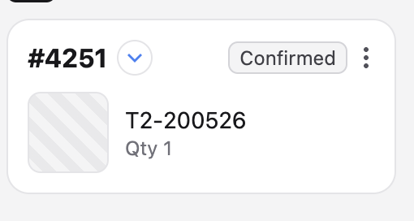

# 12 — Order card redesign (restyle R1)

**Created:** 2026-10-25. **Status:** design given by the user 2026-10-25 (`assets/order-card-target.png`); open points answered the same day. Branch `ipad/r1-order-cards`, stacked on `ipad/phase-2b-touch-intent`. Applies to **phone, iPad and desktop** (decision D9). Panel widths are **not** changed here: the user measures how much width the new card frees, and that becomes R2.

Paths relative to `Front_end/admin-app/src`.



---

## 1. What the user decided

| Topic | Decision |
|---|---|
| External source chip (e.g. `SHOPIFY`) | **Removed** from every card. It may return later. The order *label* logic is unchanged (external orders still show `reference_number`). |
| Street address beside the number | **Removed everywhere.** It stays in order detail and on the map. |
| Item rows | Larger. Article number, then `Qty N`, then **`Position: …` kept** as a third line. |
| Two items, then "+N more" | Unchanged rule: at most **2** item rows, then the "+ N more items" label. |
| Three-dot menu | Vertical dots (as today) with a **wide tap area**. |
| Route-stop extras (stop number badge, ETA pill, stop warnings) | **Removed from the card.** They return in a later panel refactor as a vertical timeline beside the cards. Stop warnings remain visible in the order detail page (`useOrderDetailPage.controller.tsx`). |

## 2. Cards in scope

| Component | Where it shows | Change |
|---|---|---|
| `features/order/components/cards/OrderCard.tsx` | main order list, store-pickup and international-shipping plan lists (`OrderList`), customer order history (`CostumerDetailOrdersListView`), address-group children — all through `DraggableOrderCard` | the new design |
| `features/plan/routeGroup/components/cards/RouteGroupOrderCard.tsx` | local-delivery route stops, route group children | becomes a thin wrapper: keeps its route-context `openOrderDetail(...)` call, renders `<OrderCard order onOpen={...} />` (no archive handlers, so no menu, as today). Drop the props only the removed extras used (`stop`, `displayStopOrder`) from the card and stop passing them at its call sites; keep what `openOrder` needs. |
| `features/order/components/cards/OrderCardItemPreviews.tsx` | both cards above, and `OrderAssignmentContactWarningPopup` | the new item rows (check the popup still fits) |
| `features/order/components/cards/OrderOperationTypeBadges.tsx` | card header | add a `size` prop (`'sm'` default = today, `'md'` for the card) |
| `shared/layout/StateCard.tsx` | card header (+ 18 other users) | add a `size` prop (`'sm'` default = today, `'md'` for the card); **do not** change the default |
| `features/order/item/components/ItemCard/ItemImagePopover.tsx` | thumbnail with images | add an optional thumbnail class prop; default stays `h-14 w-14` for its other users |
| `features/order/components/cards/OrderDragOverlayCard.tsx` | drag preview | align typography and radius with the card (label size, `rounded-2xl`, thumbnails). Keep its compact one-row layout and its `orderNumberAddon` (the live stop number while reordering is drag feedback, not card content). |

Out of scope: `features/ai/components/AiOrderCard.tsx`, the address-group header card, panel widths.

## 3. Layout (measured from the screenshot; use theme tokens, no new `text-[Npx]` literals)

```
┌──────────────────────────────────────────────┐  rounded-2xl, border border-border, p-4
│ #4251  (v)                   [Confirmed]  ⋮  │  header row, items-center, justify-between
│                                              │  gap-3
│ ┌──────┐  T2-200526                          │  item row: thumb + text column, gap-3
│ │ img  │  Qty 1                              │
│ └──────┘  Position: A-12                     │
│ ┌──────┐  …second item…                      │  max 2 rows
│ + 3 more items                               │  aligned with the text column
└──────────────────────────────────────────────┘
```

- **Order label:** `text-2xl font-bold leading-none tracking-tight`.
- **Operation badge (`md`):** circle `h-7 w-7` with the light-blue border, arrow `h-3.5 w-3.5`; one circle per direction, as today.
- **State pill (`md`):** `rounded-md px-2.5 py-1`, label `text-sm`; colours from the state as today (the screenshot's grey is the "Confirmed" state colour).
- **Menu trigger:** vertical dots `4px`, trigger `h-11 w-11 rounded-full` with `-mr-2` so the dots line up with the card edge, plus `touch-hit-area`; hover `bg-surface-hover`. It must keep stopping pointer/mouse/touch down (it already does), so tapping it never starts a drag.
- **Item row:** thumbnail `h-16 w-16 rounded-xl border border-border` (striped placeholder via `RemoteImage` when there is no image); text column `min-w-0`:
  - article number `text-lg font-medium leading-tight text-[var(--color-text)]`, truncated;
  - `Qty N` (no colon) `text-sm text-[var(--color-muted)]`;
  - `Position: …` `text-sm text-[var(--color-muted)]`, truncated.
- **"+ N more items":** `text-sm text-[var(--color-muted)]`, left padding = thumbnail + gap (`pl-[76px]`).
- **Unchanged and still present:** archived badge, `OrderCardMissingInfoBanner` (adjust its negative margins to the new padding and radius), `OrderCardNotesTray`, hover/`isHovered` states, the Phase 2b drag cue, `dnd-touch-source`.
- **Removed:** external source chip, `·` separator, street address; on route stops `StopOrderAvatar`, the ETA pill / `OrderTimeLoadingPill`, `RouteStopWarnings`.
- Card surface: keep the theme's card surface classes (`admin-glass-panel admin-surface-compact`, sheen) so light and dark themes keep working; only the radius, spacing and content change.

## 4. Preview rule as a pure function

Move the "+N more" arithmetic out of the component into `features/order/domain/orderItemPreviewSummary.ts`:

`resolveOrderItemPreviewSummary(previews, totalItems, maxRows = 2) → { rows, extraCount }`. The rows are the first `maxRows` previews; `extraCount = max(0, totalItems − units covered by those rows)`, counting `quantity ?? 1` per row.

Vitest cases: no previews; one preview with qty 1 and total 1 (no label); two previews and more units (label); more than two previews returned (only 2 rows, extras counted); quantity missing (treated as 1); total smaller than the previewed units (0, never negative).

## 5. Acceptance

- Visual match with `assets/order-card-target.png` on desktop (1440), iPad (1024, coarse) and phone (390) for: an order with one item without an image, two items with images and "+N more", an archived order, an order with missing info, an order with notes, a route stop, and a store-pickup plan list.
- `grep -n "external_source" features/order/components/cards/OrderCard.tsx` shows no rendered chip; `RouteGroupOrderCard.tsx` no longer imports `StopOrderAvatar`, `RouteStopWarnings` or `OrderTimeLoadingPill`.
- Menu: on the iPad, tapping anywhere in the 44px area opens it, and it never starts a drag.
- Gates green (lint 0 errors, tests incl. §4, build, popup contract, theme regression, PWA checks, `git diff --check`).
- After it lands, the user measures the narrowest comfortable card width; record it in `08` as the input for R2 (panel widths).

## 6. Content scale knob (user, 2026-10-25)

The R1 content felt too big; it is now 20% smaller through one knob: `ORDER_CARD_SCALE` (0.8) in `features/order/components/cards/orderCardScale.ts`. The card sets `--order-card-scale`; `index.css` `.order-card*` classes size the number, article, Qty/Position lines, "+N more", thumbnails, padding, gaps and the missing-info banner bleed from it. The state pill and arrow badge switch to their small size below `ORDER_CARD_SMALL_CHIPS_BELOW` (0.9). The menu's visible button is 32px with a `touch-hit-area` reaching 52px. On coarse pointers the small text is floored at 12px.
